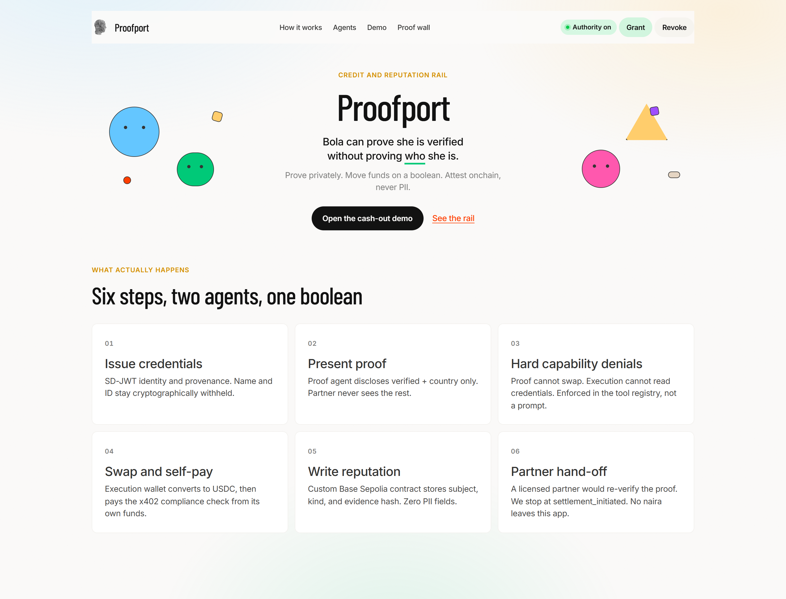
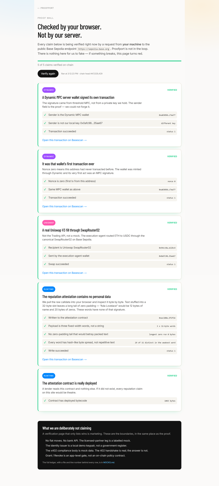
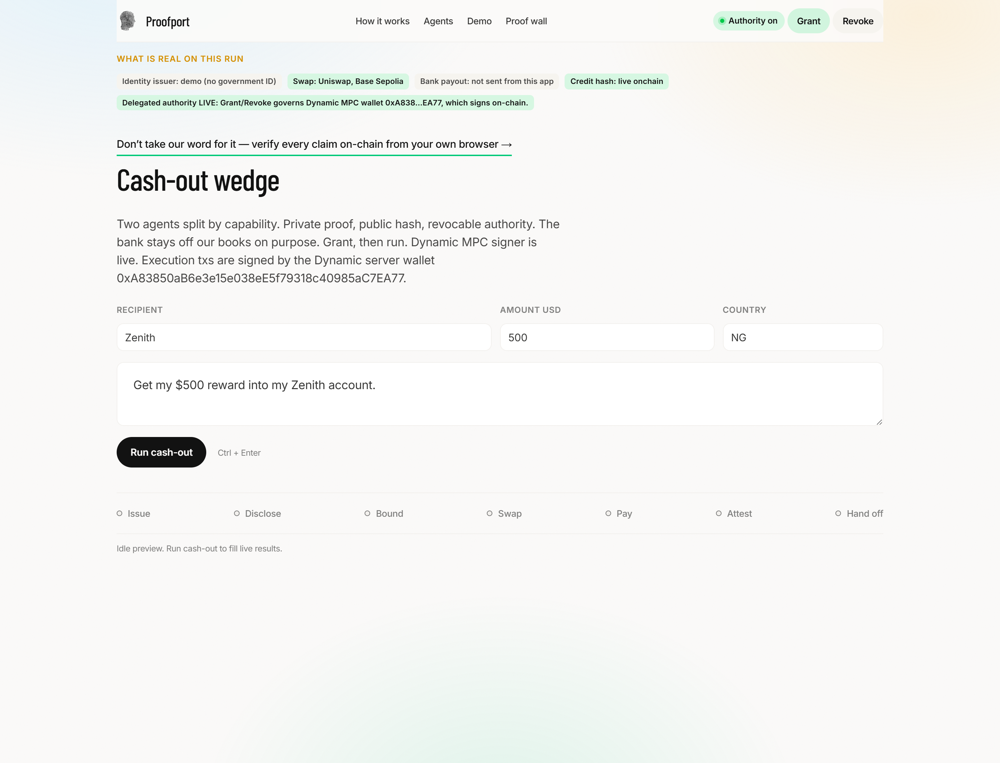
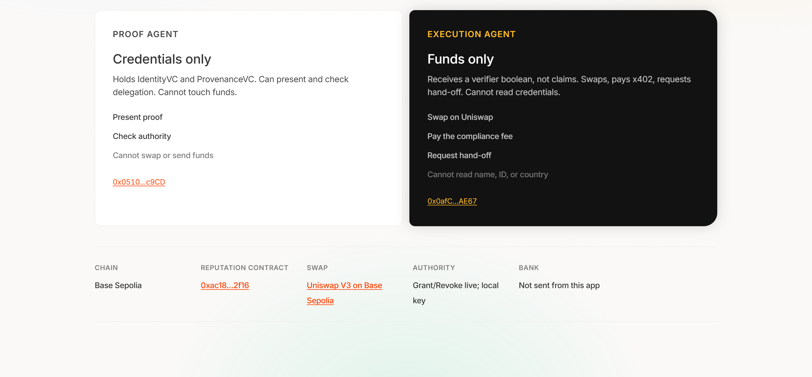
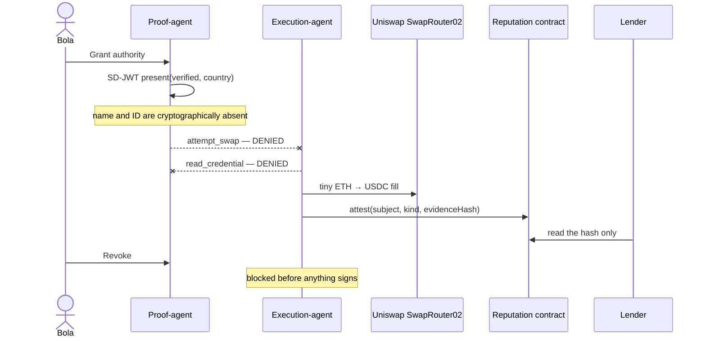
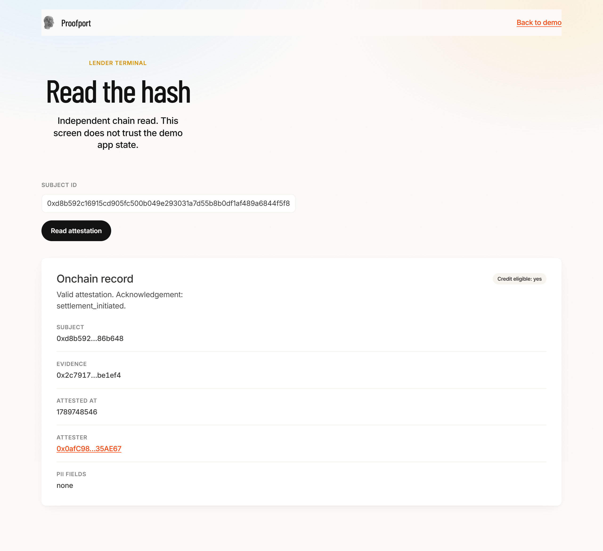

<p align="center">
  
</p>

<p align="center">
  <strong>Two agents split by capability.</strong><br />
  Private proof · public hash · revocable authority<br />
  <em>The bank stays off our books on purpose.</em>
</p>

<p align="center">
  <a href="https://sepolia.basescan.org/address/0xac188e1e9d624b346006dfe233290751165f2f16">Base Sepolia</a>
  ·
  <a href="https://sepolia.basescan.org/tx/0xd4ddc55d5a6db1efe065fb6151712da244eb3a3aaa5908558b6a50e8721346d3">Uniswap V3</a>
  ·
  <a href="https://sepolia.basescan.org/tx/0x85fd02dd919213773d969ba998aac04533750aa31fc987c0e31e6cd633465d04">Dynamic MPC</a>
  ·
  <a href="https://github.com/Demiladepy/Proofport/blob/main/MOCKS.md">Honesty ledger</a>
</p>

---

# Proofport

## Bola needs credit. She does not need to hand over her identity.

Bola is a freelancer in Lagos with three years of steady client payments behind
her. To get working capital she is asked, as everyone is, to upload her full
name, her ID number and her date of birth to a company she has no particular
reason to trust — and then to hope that file is never breached, sold, or handed
to someone who asks for it. She has no way to prove she is a real, verified,
adult human **without** also proving exactly *which* human she is.

Verification and identification got welded together. There is no technical
reason for that, and the cost of it lands on people like Bola.

Proofport takes them apart. Her proof-agent discloses only what the counterparty
actually needs — that she is `verified`, and at most her `country` and whether she
is `over_18`. Her full name and ID number are not in that set and cannot be added
to it. They are not hidden by our interface; they are **cryptographically absent
from the presentation**. A second agent acts on that proof and is structurally
incapable of reading her identity — the call throws in the tool registry, not in a
prompt we hope a model obeys. What lands on-chain is a hash a lender can check and
nobody can reverse.

The lender gets a signal it can trust. Bola keeps her name. And neither of them
has to take our word for any of it — `/proof` re-verifies the whole chain from
your own browser.

> **Why this build exists.** This started with my own bank. Opening the account
> meant handing over every identifying document I had, to be stored indefinitely,
> so that a form could confirm one bit of information about me. I am not naming
> the bank, because they did nothing unusual — that *is* the industry default, and
> that is the point. Proofport is what the same interaction looks like if you only
> answer the question that was actually asked.

<p align="center">
  
</p>

Onchain credit-and-reputation rail for agentic finance. Built for Runtime
(Bankr × Propaganda). **Not** a consumer cash-out app. We are deliberately not a
money transmitter.

```
 the lender learns              the lender never learns
 ─────────────────              ──────────────────────
 verified = true                Bola's name
 country  = NG                  her ID number
 over_18  = true   (optional)   her date of birth
                                which human she is
```

---

## For judges — read this first

**The chain is the proof. The hosted URL is the walkthrough.** Every claim below
is verifiable from any browser via Base Sepolia explorer links, with no setup and
no trust in us. If the hosted demo is asleep, the receipts still stand.

### The fastest check: open `/proof`

The app has a **proof wall** at [`/proof`](src/app/proof/page.tsx) that verifies
every claim *from your own browser*, live against Base Sepolia. Base's public RPC
sends `access-control-allow-origin: *`, so the requests leave your machine and go
straight to the chain — our server is not in the loop and has nothing to fake. If
a claim breaks, the page turns red. It also lists, on the same page, everything we
deliberately do **not** claim.

<p align="center">
  
</p>

<p align="center"><sub>Captured live. 5 of 5 claims verified against chain head. The black panel is the mock list — honesty sits next to the receipts.</sub></p>

### Or verify by hand, without running anything

| Track | Claim | Open this | Look for |
| --- | --- | --- | --- |
| **Uniswap** | Real V3 fill via SwapRouter02 | [`0xd4ddc55d…1346d3`](https://sepolia.basescan.org/tx/0xd4ddc55d5a6db1efe065fb6151712da244eb3a3aaa5908558b6a50e8721346d3) | `to` = SwapRouter02 `0x94cC0AaC…`; pool sent `0.395801` USDC |
| **Dynamic** | An MPC server wallet signed its own tx | [`0x85fd02dd…465d04`](https://sepolia.basescan.org/tx/0x85fd02dd919213773d969ba998aac04533750aa31fc987c0e31e6cd633465d04) | **`from` = `0xA83850aB…EA77`** — the Dynamic wallet, not our key |
| **Dynamic** | It was that wallet's first-ever tx | [`0xd96b57f6…c8c9e1`](https://sepolia.basescan.org/tx/0xd96b57f60add3852d684676343a0528947f380b9fdea65d85661f1b473c8c9e1) | `nonce = 0` from the same address |
| **Runtime** | Reputation attestation carries no PII | [`0xd546a412…cdef8`](https://sepolia.basescan.org/tx/0xd546a412a54646441b33990c3bd91854e6fe65d04ee97ca7eb1a73979c7cdef8) | Input is `subject` / `kind` / `evidenceHash` — three hashes, no name, no ID |

That Dynamic `from` field is the whole claim. A local private key cannot produce it.

### What works on a running instance

Grant → run the pipeline → selective disclosure, both capability denials, the
Uniswap leg, the on-chain attestation, `/lender` reading chain-only, then Revoke
blocking the run. Every step is labeled Simulated or Live on screen.

<p align="center">
  
</p>

### What is local-only, and why

**Dynamic MPC signing does not run on the hosted deploy.** `@dynamic-labs-wallet/node`
ships MPC binaries for linux/macos only, and the signer holds key shares that are
gitignored and never deployed — putting them in a hosting env var would be the
wrong call. So the hosted app reports `signer: "local_viem"` and says so on screen.
**It never claims MPC it cannot currently perform.** The signatures in the table
above already happened; the explorer is the receipt.

To reproduce it yourself (Linux, or Windows + WSL):

```bash
npm run mpc:serve   # sidecar on 127.0.0.1:18787
npm run mpc:sign    # one signature -> .data/dynamic-mpc-proof.json
```

`mpc:sign` prints the tx hash. Check `from` on the explorer — it is the Dynamic
wallet. With `mpc:serve` running, the full app run signs through it too, and the
authority chip flips to "Grant/Revoke governs Dynamic MPC wallet … which signs on-chain."

### What we are not claiming

No fiat moves. No bank API. No money transmission. The licensed-partner leg is
`MockLicensedPartner` and is labeled **SIMULATED** everywhere it appears — that is a
deliberate legal boundary, not an unfinished feature. Full ledger: [`MOCKS.md`](MOCKS.md).

---

## The two agents cannot cross

<p align="center">
  
</p>

The split is not a prompt. `denyCapability` throws in the tool registry. The
proof-agent cannot call `attempt_swap`. The execution-agent cannot call
`attempt_read_credential`. The call does not return.



A lender never talks to our demo state. `/lender` reads the contract and returns
`creditEligible` plus `piiFields: []`.

<p align="center">
  
</p>

---

## What is LIVE vs SIMULATED

Statuses match [`MOCKS.md`](MOCKS.md) exactly. Every LIVE row there has a tx hash or file+line.

| Surface | Status | Why |
| --- | --- | --- |
| SD-JWT selective disclosure | **LIVE** | Cryptographic withholding via `@sd-jwt/sd-jwt-vc` ([`src/credentials/index.ts`](src/credentials/index.ts) `present`) |
| Capability denials | **LIVE** | Hard throw in the tool registry ([`src/agents/capability.ts`](src/agents/capability.ts) `denyCapability`) |
| Reputation attestation | **LIVE** | Base Sepolia [`0xac188e1e…f16`](https://sepolia.basescan.org/address/0xac188e1e9d624b346006dfe233290751165f2f16), hashes only. Example write [`0xd546a412…cdef8`](https://sepolia.basescan.org/tx/0xd546a412a54646441b33990c3bd91854e6fe65d04ee97ca7eb1a73979c7cdef8) |
| Lender chain read | **LIVE** | [`/lender`](src/app/lender/page.tsx) · `GET /api/reputation` |
| Revocable authority | **LIVE** (app-level Grant/Revoke) | Cookie + file gate, not an on-chain policy contract. Binds to the Dynamic MPC wallet when the signer is up; Revoke blocks the run before anything signs. |
| Execution-agent signing | **LIVE** | Swap + attestation signed by local viem key `0x0afC983C…`. The authority-proof step in the same run is signed by the Dynamic MPC wallet. |
| Dynamic server-wallet MPC sign | **LIVE** (needs a Linux runtime) | Server wallet `0xA83850aB…` signs on-chain. Agent-run tx [`0x85fd02dd…465d04`](https://sepolia.basescan.org/tx/0x85fd02dd919213773d969ba998aac04533750aa31fc987c0e31e6cd633465d04) — `from` is the MPC wallet. The SDK has no win32 MPC binary, so signing runs in WSL (`npm run mpc:serve`); with it down the app reports `local_viem` and says so. |
| x402 402 → retry | **LIVE header / SIMULATED result** | Protocol loop is real; body is `mock_compliance`. No ExactEvmScheme settlement tx. |
| ID issuer (NIN/BVN stand-in) | **SIMULATED** | Legal / no government issuer |
| Licensed partner / bank | **SIMULATED** | Legal: we do not move fiat |
| OpenAI claim pick | **MIXED** | Allowlisted model pick when keyed; otherwise labeled fallback |
| Uniswap Trading API | **UNUSED** | Auto path is SwapRouter02. Trading API 404’d on Base Sepolia ETH/USDC. |
| Uniswap swap | **LIVE** on Base Sepolia (tiny ETH→USDC) | SwapRouter02 fill [`0xd4ddc55d…1346d3`](https://sepolia.basescan.org/tx/0xd4ddc55d5a6db1efe065fb6151712da244eb3a3aaa5908558b6a50e8721346d3). Calldata [`src/swap/uniswap.ts`](src/swap/uniswap.ts). Mock only if that path throws. |

Full ledger with every citation: [`MOCKS.md`](MOCKS.md). Form paste + shot-list: [`SUBMISSION.md`](SUBMISSION.md).

---

## Demo

```bash
npm run dev
```

Grant authority, then **Open the cash-out demo** (starts the pipeline; it is not a
same-page dummy link). Every step is labeled Simulated or Live. Revoke locks the
run.

Lender terminal (chain read only): `/lender`. Proof wall: `/proof`.

Regenerate these README shots from a running app:

```bash
npm install --no-save playwright
node scripts/capture-readme-shots.mjs
```

---

## Stack

Next.js 16 · TypeScript · viem · Base Sepolia · `@sd-jwt/sd-jwt-vc` · x402 · optional OpenAI for one proof-agent claim decision.

## Quick start

Node 22+.

```bash
cp .env.example .env
npm install
npm run compile:reputation
npm run deploy:reputation
npm run dev
```

Fund the execution wallet on Base Sepolia (ETH + Circle USDC). Set `EXECUTION_AGENT_PRIVATE_KEY` or `DEMO_AGENT_PRIVATE_KEY`. Never commit `.env`.

### Dynamic MPC signer (Linux only)

`@dynamic-labs-wallet/node` ships MPC executors for linux/macos only — there is
no win32 binary, so Next.js on Windows cannot sign in-process. The signer runs
out-of-process and the app talks to it over localhost:

```bash
npm run mpc:serve
```

On Windows that shells into WSL; on Linux run `bash scripts/start-dynamic-wsl.sh`.
It bootstraps a Linux-native SDK install in `~/proofport-mpc` on first run (npm
resolution over the `/mnt/c` 9p mount is unusably slow), then listens on
`127.0.0.1:18787` with `GET /health` and `POST /sign`.

For a single signature without the server:

```bash
npm run mpc:sign
```

Both write the receipt to `.data/dynamic-mpc-proof.json`. With the signer down
the app reports `signer: "local_viem"` and the UI says so — it never claims MPC
it cannot currently perform.

## Scripts

```bash
npm run smoke:credentials
npm run smoke:capability
npm run smoke:wallet
npm run smoke:reputation
npm run smoke:x402
npm run smoke:partner
npm run smoke:delegation
npm run smoke:swap
npm run smoke:agent
npm run preflight          # 22-check audit before recording
```

## Where to look

| What | File |
| --- | --- |
| SD-JWT `present()` / `verify()` | [`src/credentials/index.ts`](src/credentials/index.ts) |
| Capability-denial throw | [`src/agents/capability.ts`](src/agents/capability.ts) `denyCapability`; orchestrator wiring in [`src/orchestrator/index.ts`](src/orchestrator/index.ts) |
| Reputation write / read | [`src/reputation/index.ts`](src/reputation/index.ts) |
| Contract | [`contracts/ReputationAttestation.sol`](contracts/ReputationAttestation.sol) at [`0xac188e1e…f16`](https://sepolia.basescan.org/address/0xac188e1e9d624b346006dfe233290751165f2f16) |
| Grant / Revoke | [`src/delegation/index.ts`](src/delegation/index.ts); [`src/app/api/delegation/route.ts`](src/app/api/delegation/route.ts) |
| Dynamic MPC signer (Linux sidecar) | [`scripts/dynamic-wsl-signer.mjs`](scripts/dynamic-wsl-signer.mjs) · one-shot [`scripts/dynamic-mpc-sign.mjs`](scripts/dynamic-mpc-sign.mjs) |
| Dynamic MPC app client | [`src/wallet/dynamic-mpc.ts`](src/wallet/dynamic-mpc.ts) |
| Uniswap SwapRouter02 fill | [`src/swap/uniswap.ts`](src/swap/uniswap.ts) |
| Dual wallets / execution key | [`src/wallet/dual.ts`](src/wallet/dual.ts) |
| Lender (chain-only) | [`src/app/lender/page.tsx`](src/app/lender/page.tsx) · [`src/app/api/reputation/route.ts`](src/app/api/reputation/route.ts) |
| Proof wall (browser → chain) | [`src/app/proof/page.tsx`](src/app/proof/page.tsx) |
| x402 header loop / mock body | [`src/payments/x402.ts`](src/payments/x402.ts) |
| Partner (simulated) | [`src/partner/index.ts`](src/partner/index.ts) |

## License

Private hackathon build for Runtime AgentWeek unless the owner states otherwise.
